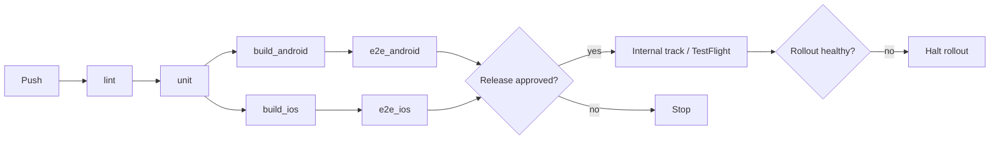

# Stakeholder matrix and DevOps user journey

## Stakeholders (typical roles)

| Role | Cares about | Usually owns / approves |
|---|---|---|
| Developer | Fast feedback on their MR/PR, clear failure reason | Triggers; owns lint + unit stages |
| Reviewer / tech lead | Diff quality, test evidence on the MR | Merge approval |
| QA | Testable builds, E2E reports, device coverage | E2E stage; sign-off before release |
| Release manager | Version, changelog, store/rollout state | Release gate, rollout percentage |
| Security | Secrets handling, dependency and SAST findings | Security scan gate, OIDC trust policies |
| SRE / Ops | Deploy safety, rollback, observability | Production environment approval, runners |
| Product / PM | What shipped, when, to whom | Store release notes, phased rollout go/no-go |
| Store reviewers (Apple / Google) | Policy compliance, metadata | External gate — plan review time into the schedule |
| End users / testers | Installable build | Receive TestFlight / internal track / Firebase builds |

## Matrix template

| Stage | Input | Output | Owner | Approver | Notified |
|---|---|---|---|---|---|
| lint | MR source | lint report | Developer | — | MR author |
| unit test | MR source | JUnit + coverage | Developer | — | MR author |
| build | main / tag | AAB, IPA, image | CI | — | — |
| e2e | build artifact | E2E JUnit, video | QA | QA (on release branch) | QA channel |
| deploy staging | image / build | running env URL | CI | — | QA, PM |
| release gate | staging sign-off | approved tag | Release manager | Release manager + QA | team |
| deploy prod / store | approved tag | prod / store track | CI | SRE (prod), RM (store) | everyone |
| monitor | prod metrics | rollback decision | SRE | SRE | on-call |

Fill every cell. An empty Approver on a production stage is a finding.

## DevOps user journey (template)

1. Developer branches from `main` and pushes. **Push pipeline:** lint + unit, under ~10 minutes.
2. Developer opens an MR/PR. **MR pipeline:** full tests, build, optional review app or internal build; results surface as MR widgets (JUnit, coverage).
3. Reviewer approves; merge to `main`. **Main pipeline:** build once, publish the artifact, deploy to staging automatically.
4. QA verifies on staging / internal track. Nightly regression runs on `main`.
5. Release manager cuts a tag (or a release branch). **Release pipeline:** promote the *same* artifact — never rebuild for prod.
6. Production / store gate: manual approval by the named approver; staged rollout (store percentage or canary).
7. Monitor: health checks and crash rates; the rollback decision is explicit.
8. **Hotfix lane:** branch from the release tag → MR → fast pipeline (no nightly-only suites) → tag → same promotion gates.
9. **Rollback lane:** redeploy the previous artifact (web/backend), halt the staged rollout (Play), or stop phased release (App Store). Mobile cannot un-ship; plan a forward fix.

## Flow diagram template

